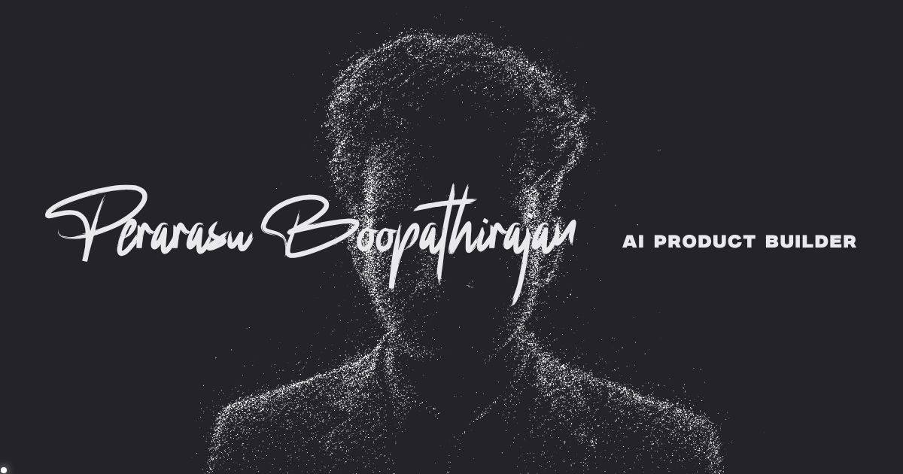

# Perarasu Boopathirajan · Portfolio

**Live site:** https://perarasuboopathirajanm.github.io/



An interactive portfolio built around a single WebGL particle field. Around 40,000 particles assemble into a portrait, then reshape as you scroll into a sphere, maps, a DNA helix, a medal and a contact frame.

## Features

- **Particle loader:** particles gather into a progress ring, burst, and form the portrait
- **Scroll-driven morphing:** one particle system changes shape for every section
- **Pearl-coated project cards:** WebGL shader cards with an iridescent coating that dissolves on hover or tap
- **Interactive contact:** the email address breaks into particles under the cursor and reassembles
- **Custom cursor** with a comet trail
- Responsive layout for desktop and mobile, with `prefers-reduced-motion` support

## Tech stack

| Area | Tools |
|---|---|
| Rendering | three.js (WebGL), custom GLSL shaders, Canvas 2D |
| Front end | HTML5, CSS3, vanilla JavaScript (no framework, no build step) |
| Hosting | GitHub Pages |

## Project structure

```
index.html        Page markup and meta tags
css/style.css     Layout, typography and responsive styles
js/main.js        Loader, particle system, shaders and interactions
js/maps.js        Map outline data for the particle maps
assets/           Images, certificates, portrait map and fonts
```

## Run locally

```bash
python -m http.server 8000
# then open http://localhost:8000
```

## Credits

Fonts: Milker (Brandsemut) and Rockybilly (Letterara Studio).
Map outlines: Natural Earth via world-atlas.

© 2026 Perarasu Boopathirajan. All rights reserved.
